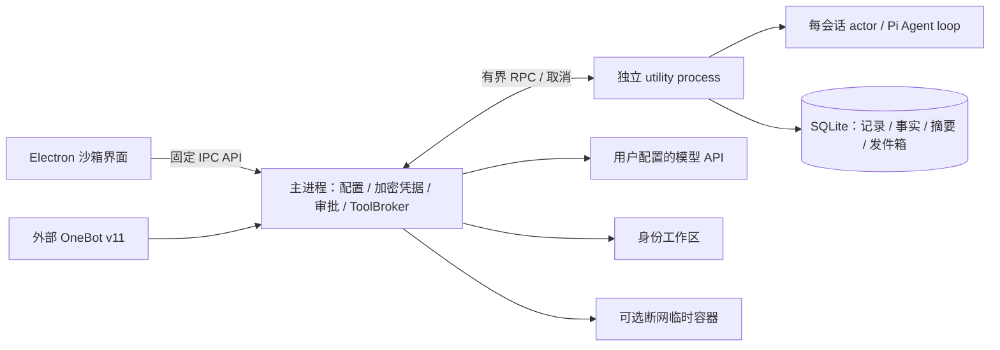

# 架构与上游取舍

## 运行边界

Renderer 无 Node、文件系统、密钥或直接网络权限。模型请求由主进程注入对应接口的密钥。运行进程处理队列、agent loop 与 SQLite；可信的主进程 broker 根据原始消息编号核对身份，模型不能通过工具参数伪造 actor、群或模式。utility process 用于资源管理和 UI 响应，不被描述为隔离任意恶意 Node 程序的安全沙箱。

## 为什么没有整体搬入一个大框架

核心选择是单一 Node/Electron 运行栈、Pi 的协议和循环、小范围移植已验证的 MaiBot 去抖组件。这样发布物不需要再托管完整 Python 聊天框架，也不需要随应用打包 QQ 客户端。通道独立于 agent，不把 NapCat 的生命周期当成核心前提。

具体依赖行为以固定版本代码为依据：

- [Pi `agent-loop.ts`](https://github.com/earendil-works/pi/blob/4afe78de1e51162c01c946dcf080e6a266685a01/packages/agent/src/agent-loop.ts)：使用 `prepareRequest` 刷新上下文与工具，`beforeToolCall` 检查即时能力，`finishTurn` 在陪伴的回复／等待／结束决定后结束本轮，避免无意义的第二次模型调用。安装版本固定为 1.5.2。
- [Pi `agent.ts`](https://github.com/earendil-works/pi/blob/4afe78de1e51162c01c946dcf080e6a266685a01/packages/agent/src/agent.ts)：订阅真实循环事件，取消 agent，并等待退出释放状态。超长上下文从 `prepareRequest` 抛错，不能把“返回 undefined”误当成取消请求。
- [MaiBot `controller.py`](https://github.com/Mai-with-u/MaiBot/blob/478f671e64467121fd3e39205c8d3507b5ce0bd6/src/chat/debounce/controller.py)：保留快速、自然、稳态的去抖时限与批次上限，独立验证 Python 原件后再移植到 TypeScript。来源和哈希随仓库提供。

事实存储采用 SQLite FTS5 与 `Intl.Segmenter` 中文分词，没有直接引入向量数据库或 Mem0 服务。这是 v1 的部署与可核查性选择：来源、作用域、删除与摘要失效可在同一个本地事务中处理。代价是语义召回较弱，相关事实少时会补充近期事实；后续可通过检索接口替换。

## 陪伴是一套消息调度

单独把“像人说话”写进人设解决不了连续消息、引用和插话时机。这里先保存原始消息，再按会话合并；等待区有上限，活动会话可回收。纯陪伴默认 fast 私聊 / natural 群聊去抖，同一人继续补充时可撤销尚未发出的旧回复，紧急更正词也触发取消。已经提交发送的消息不假装能撤回。

每批传入消息编号、发言人、时间和核实过的引用。允许模型 `chat_reply`、`chat_wait`、`chat_end`；等待／结束不设置不断唤醒的自循环。群内自主判定需额外开关、速率与 token 预算。默认人设用普通口语示例，取消每轮强制括号动作。输出风格仍受模型能力影响，需独立评测。

## Prompt 与权限刷新

system prompt 按固定规则、程序能力、风格资料、技能目录、检索事实、历史摘要组合。人设和其他资料经过 JSON 引用，但引用本身不是防注入的完整保障。真正的限制是宿主 broker 对模式、身份、通道、触发来源、全局开关、工作区和容器状态求交集。

模型看到的工具声明由同一份能力快照生成。每次模型请求、工具调用和写入提交都重新核对。审批绑定运行编号、工具、完整参数、配置 revision、哈希和过期时间；取消任务、撤权或修改参数使确认失效。QQ 文字不能修改权限。

技能是有哈希的只读资料快照；目录只列名称、描述和资源，正文按需读取。技能描述也属于不可信内容。文件数、大小、路径、链接和修改后的哈希都受检查。技能里的 shell 示例不会在宿主执行。

## 记忆与压缩

原始消息、模型回合、长期事实与摘要分开保存。长期事实有 subject、scope、sourceIds；桌面与主号私聊统一为 `person:owner`，群是独立 `group:<conversationId>`。明确「记住」直接保存；自动提取在后台每批调用一次，要求 sourceId、原文连续 quote 与确定事实，程序据真实来源绑定 subject。模型不选择用户身份。

模型回合保存被检索事实的依赖，并向后传播，删除事实时可使由该事实产生的后续回复失效。原始历史保留供界面查看。摘要分批压缩较早的完整回合，保留最近四回合；固定提示无工具、单独预算，待处理任务落盘。对话上下文只按完整 user-turn 裁剪，保留工具 call/result 配对；当前回合仍过长则拒绝网络请求。

自动提取不能保证语义绝对正确。引用、敏感词、假设词、来源匹配等程序约束只降低风险，界面提供核对和忘记。后台使用量归入总输入／输出，并额外记入背景预算；达到预算保留队列稍后处理。

## 资源与交付

前台默认并发 2、每会话 pending 20、全局 pending 200、活动 actor 128。模型运行、审批、OneBot RPC 与容器都有期限；RPC 关闭和 abort 会清理等待表与监听。配置、密钥与数据库由各自单一所有者写入。运行日志有有界排队和轮转。

QQ 发件箱先记录 pending，断线未确认标为 unknown，重启不重放。迁移只由桌面显式发起，哈希匹配、先备份再事务导入。构建产物排除测试、数据库、凭据、旧版目录和账号缓存。GitHub CI 验证核心与 Windows 打包，单独 Linux Docker job 执行真实隔离测试。
